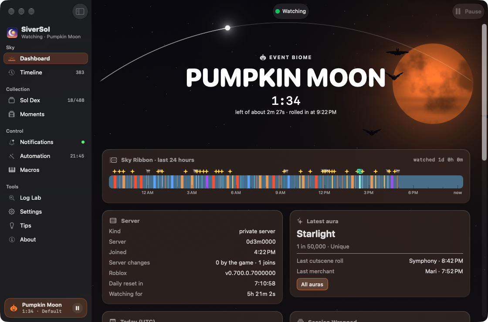
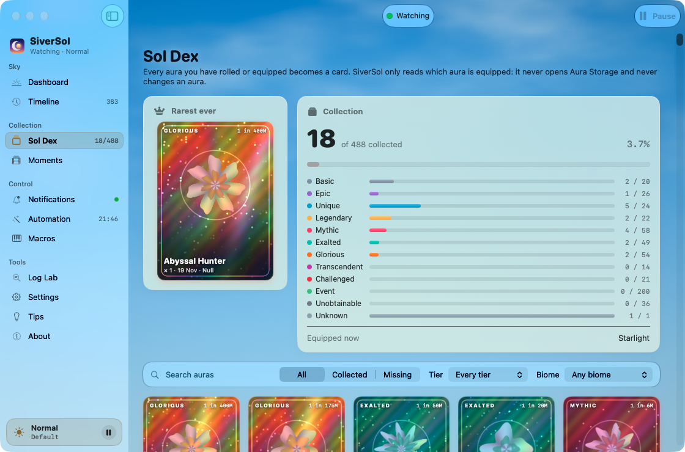
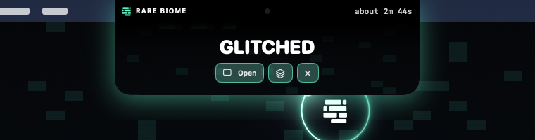
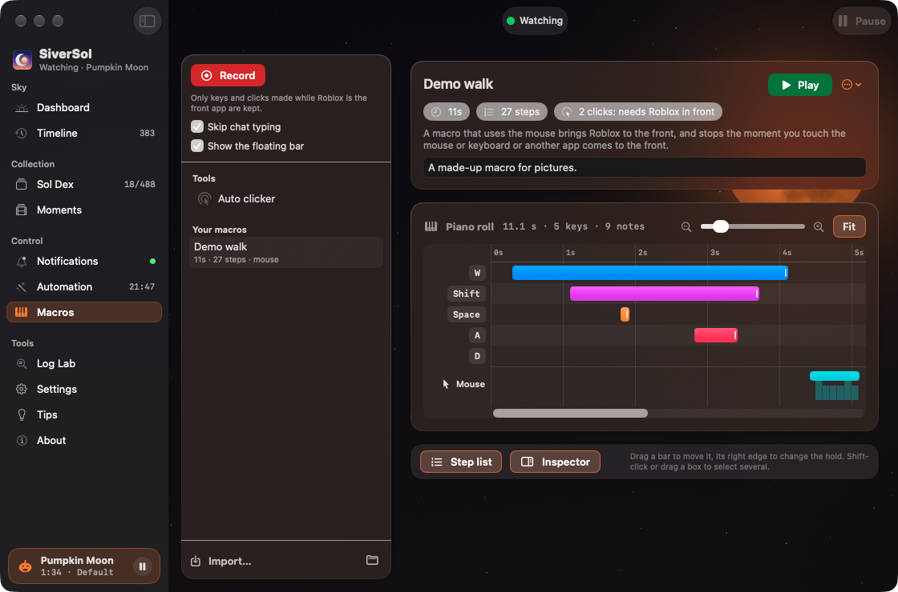

# SiverSol

A native Mac app that watches **Sol's RNG** (Roblox) while you are away and tells your Discord what happened. It knows the biome and your aura from the Roblox log, posts to your own Discord webhooks, keeps the session alive, brings Roblox back after a disconnect, and lets you record and replay your own macros.

Apple Silicon Macs, macOS 14 or later. Free, no account, no analytics.





## What makes SiverSol different

- **The Living Sky.** The whole window is the sky of the biome you are in: its colours, its weather, the sun or moon crossing an arc as the biome runs out. A new biome arrives as a weather front.
- **The Biome Island.** A small live view of the biome and its timer at the top of the screen (beside the notch on a MacBook). It opens up for a rare biome or a rare roll, never takes a click from Roblox and never takes the keyboard.
- **Sol Dex.** Every aura you have rolled becomes a trading card, with foil that gets livelier the rarer the aura.
- **Sky Ribbon and Session Wrapped.** A day of sky as one strip you can read at a glance, and a recap card when a long session ends.
- **Sky Cards.** The Discord messages wear the same sky. Hunt-Compat messages stay in the exact plain format glitch-hunt bots read.
- **Moments.** Short clips of rolls and rare biomes, kept on your Mac, with the chat and the player list covered. Off until you turn it on.
- **Profiles.** One click switches routes, pings, macros and the island together. Glitch Hunt is made for sharing a server with a hunt group.
- **A piano roll for macros.** Every key press is a bar you can drag.
- **A few rare surprises.** Now and then the sky does something of its own while you are looking. Just for fun: it does not change your in-game luck, and nothing about it is ever sent to Discord. You can turn it off in Settings.

All the visuals are original. The skies, glyphs, cards and foil are drawn by SiverSol's own shaders and code; nothing is taken from the game.



> SiverSol is not affiliated with Roblox or Sol's RNG. Roblox's terms treat automation as a gray area. SiverSol is meant for your own account on your own private server; use it at your own risk.

## What it does

| | |
|---|---|
| **Biome Radar** | Reads the Roblox log, so a biome change reaches Discord about a second after the game knows. Unknown biomes are learned and announced, not ignored. |
| **Discord alerts** | Any number of webhooks ("routes"), each with its own filters. Nothing is lost while you are offline: messages queue on disk and go out in order, rare biomes first. |
| **Rich messages** | Started and Ended messages link to each other, the Started message is edited when the biome ends, and there is a Join button for your server. |
| **Hunt-Compat** | Plain `Biome Started - NAME` messages that glitch-hunt bots can read. Never edited, never faked. |
| **Live session card** | One message, updated every minute: biome with a progress bar, uptime, today's tallies, your aura, Roblox health. |
| **Aura watch and roll feed** | A message per new aura with its odds from the wiki catalog, and "Rolled …" with a screenshot for cutscene rolls. |
| **Merchants** | Mari, Jester and Rin, read from the chat on screen. |
| **Anti-AFK** | Presses Space in Roblox every 12 to 17 minutes. The key goes straight to Roblox in the background, so your own typing is never interrupted. |
| **Auto-rejoin** | Notices a disconnect, a closed Roblox, a frozen screen or the start menu, reopens your private server, clicks Play and posts what it did. |
| **Macro Studio** | Record what you do in Roblox and play it back, with an editor, triggers and an auto clicker. See below. |
| **Proof shots** | A screenshot on rare biomes, very rare auras and merchants. The chat and the player list are covered first. |
| **Daily report** | At 00:00 UTC: totals and a chart of biome time per hour. |
| **Extras** | Session facts (private or public server, joins), daily reset countdown, Roblox memory and CPU charts, update watch, network watch, biome statistics, CSV and JSON export, a Log Lab that shows what the log is saying. Each has its own switch. |
| **Guardian** | Every key press and click is checked against a fresh picture of the Roblox window first. See Safety. |
| **Panic key** | ⌃⌥⌘P releases every key and stops all input, from any app. |
| **Digest** | Ordinary biomes gathered into one Discord message an hour, edited in place. Rare biomes, rolls and merchants still post on their own. |
| **Battery guard** | On a MacBook: a calm message when it goes on battery during a run, and again below 20%. |
| **Tips** | A page of short tips and one tip a day on the Dashboard. They stay on your Mac. |

Not in 1.0: several Roblox windows at once, fishing, potion crafting, buying from merchants, and using items automatically.

## Install

1. Download `SiverSol-1.0.zip` from the [Releases](../../releases) page and unzip it.
2. Move **SiverSol** to your Applications folder and open it.
3. macOS will say it cannot check the app, because SiverSol is not signed with a paid Apple developer account. Open **System Settings → Privacy & Security**, scroll down to the line about SiverSol, and click **Open Anyway**. You only do this once.
4. Follow the setup wizard: paste a Discord webhook, paste your private server link, allow the two permissions.
5. Open Sol's RNG in your private server and press **Start**. SiverSol lives in the menu bar.

To check the download, compare its SHA-256 with the one on the Releases page:

```bash
shasum -a 256 ~/Downloads/SiverSol-1.0.zip
```

### The two permissions

SiverSol asks for **Screen Recording** and **Accessibility**, and nothing else. Biome detection and Discord alerts work without either. The full explanation is in [Privacy & Permissions](#privacy--permissions) below and behind every **?** button in the app.

Because the app is not signed with an Apple developer account, macOS ties both permissions to that exact copy of the app. After you update SiverSol you will be asked again; if the switches look on but SiverSol says they are off, remove SiverSol from both lists with **–** and allow it again.

### Making a Discord webhook

In Discord, open the channel's settings → **Integrations** → **Webhooks** → **New Webhook** → **Copy Webhook URL**. Paste it into SiverSol (the wizard, or **Notifications**). **Check webhook** asks Discord about the URL without posting anything, and **Send test** posts "✅ SiverSol is connected".

Pings are off by default. Turn on **Ping on rare biomes** per route if you want real GLITCHED, DREAMSPACE, CYBERSPACE and SINGULARITY starts to ping @everyone there. Test messages never ping.

### Using SiverSol with a glitch-hunt server

Hunt servers run a bot that reads macro webhooks. In **Notifications**, add a route, choose **Hunt-Compat**, and paste the webhook that server gave you.

- The message title is exactly `Biome Started - NAME` or `Biome Ended - NAME`, and your private server link is in a field called `Private Server Link`. This format was confirmed with the owner of a widely used hunt bot.
- Hunt-Compat messages are never edited, and only real biomes from the live game are sent in this format. Test, replayed and simulated messages cannot reach a Hunt-Compat route.
- Leave **Include NORMAL** on if the server uses it to see that your macro is active.
- Check the route once with a real ordinary biome such as WINDY. Never test a hunt server with a fake rare biome: that is a false alarm for real people.

## Macro Studio

Record what you do in Roblox and play it back. Open **Macros** in the sidebar.



**Recording.** Press **Record** (or ⌃⌥⌘R from anywhere). SiverSol brings Roblox to the front and records key presses with their exact hold times, mouse moves, clicks, drags and scrolling. Camera turns (right-drag or shift lock) are kept as movement, positions as a share of the Roblox window, so a macro still fits after the window is resized. A small floating bar and a red ● in the menu bar show that it is recording; ⌃⌥⌘E pauses, ⌃⌥⌘R stops and saves.

- Only keys and clicks made while Roblox is the front app are kept. Everything else is thrown away as it arrives.
- **Skip chat typing** (on by default) leaves out what you type after pressing `/` until Return or Escape.
- A recording keeps the keys you press inside Roblox, so do not type a password while the red ● is on.

**Playing.** Press **Play** or ⌃⌥⌘M. Per macro you can set the speed (0.25× to 10×), how many times it loops (or forever), a pause between loops, and a little random variation.

- A macro made only of keys plays **in the background**: the keys go straight to Roblox while you use other apps.
- A macro that uses the mouse needs Roblox in front. It stops at once if you touch the mouse or keyboard, or if another app comes to the front. Nothing is ever pressed or clicked in another app.
- Guardian looks at the screen before the first step, again every 5 seconds, and before every click. An Aura Storage, trade or Robux prompt stops the macro. Nothing plays during a roll cutscene.
- By default a macro stops when a rare biome starts.
- Clicks on the item bar and the menu buttons are blocked unless you allow them for that macro, and even then they are limited per hour. The same goes for any click while the Inventory or a crafting window is open, because a click there can use an item. The auto clicker never clicks in those places.
- If SiverSol is stopped, panics or crashes, every held key and button is released.

**Editing.** Select steps to trim, delete, or change a delay; merge runs of mouse moves; add smart steps: *Wait N seconds*, *Wait for text on screen*, *Wait for a biome*, *Wait until in the game*.

**Starting by itself.** A macro can start every N minutes, when a biome starts or ends, after a successful rejoin, or at the daily reset, and can start another macro when it finishes. One macro plays at a time; the rest wait their turn. Triggers work while SiverSol is running.

**Auto clicker.** Clicks where your pointer is, inside the Roblox window only: fixed or random interval, left, right or middle button, press-to-toggle or hold (⌃⌥⌘K), stop after a number of clicks or minutes, with running totals.

**Discord.** A macro can report "started", "finished" and "stopped" (with the reason, and a screenshot when Guardian stopped it) to Rich routes that have **Macros** switched on. The live card shows the macro that is playing, and the daily report counts macro runs and auto clicks. Hunt-Compat routes never receive macro messages.

**Files.** Macros are plain JSON files in `~/Library/Application Support/SiverSol/Macros/` with the extension `.svmacro`. Export one to share it. Opening someone else's `.svmacro` shows every step first; it is only added, and can only run, after you have looked. An imported macro arrives with its triggers removed.

**Links.** `siversol://macro/play?name=My%20macro` plays a macro. Because a link can come from anywhere, SiverSol asks before acting on one unless you turn that question off in Settings.

## Safety

- **Auras are never touched.** SiverSol does not click inside Aura Storage, and stops all input if a delete, lock, sell or trade control is on screen.
- **No Robux.** If a purchase dialog is on screen, SiverSol presses Escape once, stops all input and posts a ⚠️ alert.
- **Nothing is pressed blind.** If the Roblox window cannot be seen, no key or click is sent.
- **Read-only toward Roblox.** The log folder, pictures of the Roblox window, and ordinary key presses and clicks. No cookies, no memory reading, no injection, no changes to Roblox's files.
- **Rare biomes are protected.** Roblox is never restarted during GLITCHED, DREAMSPACE, CYBERSPACE or SINGULARITY unless it is already disconnected, and SiverSol only ever rejoins the private server link you saved.
- **A hunt server cannot be fooled.** Test, replayed and simulated messages are marked 🧪, only go to Rich routes that accept tests, and never ping.
- **Pings are off by default**, and only real rare biomes can ping.

## Privacy & Permissions

SiverSol asks macOS for exactly two permissions. Both can be switched off again at any time.

### Screen Recording

- **Why SiverSol asks:** It lets SiverSol take still pictures of the Roblox window, and only that window. It reads the text in them (the Play button, merchant notices in chat, the safety check before every key press), compares them to notice a frozen game, and uses them for the proof shots you choose to send to your own Discord. If you turn on Moments, it also records short video clips of that window: a roll's cutscene, and 12 seconds when a rare biome starts. Recent versions of macOS ask you to confirm this again from time to time, with a box that says SiverSol “is requesting to bypass the system private window picker”. That is this same permission, not a new one.
- **What it never does:** It never records sound, never records video unless you turn on Moments, and never captures another app's window or the whole screen. To find the Roblox window it asks macOS for the list of open windows and uses only the one that belongs to the Roblox app. A picture is only uploaded to a webhook you added yourself, and the chat and the player list are covered first. Moments clips have the same two areas covered in every frame; they stay on this Mac in Movies/SiverSol Moments (the oldest are removed when the folder passes the size you set) and are only posted to Discord if you turn that on as well. Proof shots stay in SiverSol's own folder on this Mac; ones older than a week are deleted each time SiverSol starts watching. The test screenshot from Settings is kept there too, uncovered, and is never uploaded.
- **What still works without it:** Biome detection and Discord alerts still work, because they come from the Roblox log. Proof shots, Moments and merchant reading stop. So does everything that presses a key or clicks (anti-AFK, the Play button after a rejoin, macros): SiverSol does not press anything it cannot check on screen first.
- **How to turn it off:** System Settings → Privacy & Security → Screen & System Audio Recording, then switch SiverSol off. (On older macOS the page is called Screen Recording.)

### Accessibility

- **Why SiverSol asks:** It lets SiverSol press keys and click inside Roblox: the anti-AFK key, the Play button after a rejoin, one press of Escape if a purchase dialog shows up, and the macros you make. It is also what lets SiverSol bring Roblox to the front before a click, and what lets the recorder see your keys and mouse while you record a macro.
- **What it never does:** It never presses a key or clicks unless Roblox is the front app, or the key is sent straight to the Roblox process. (Letting go is the one exception: a key or button SiverSol is holding is always released, wherever that lands, so nothing stays stuck.) It never records anything unless you press Record, and while recording it throws away every key and click made in another app. Outside a recording, a mouse macro or the auto clicker, it does not see your keys or mouse at all: it only hears its own five shortcuts, and it can ask macOS how many seconds the Mac has been idle. One thing to know: a recording keeps the keys you press inside Roblox, so do not type a password while the red ● is on.
- **What still works without it:** Detection and Discord alerts still work. Auto-rejoin can still reopen your private server. There is no anti-AFK, no click on the Play button, and no macros or auto clicker.
- **How to turn it off:** System Settings → Privacy & Security → Accessibility, then switch SiverSol off.

### Launch at login (optional)

- **Why SiverSol asks:** It opens SiverSol when you log in to this Mac, so a restart or an overnight update does not end your AFK session. It is off until you turn it on. macOS does not ask for permission; it shows its usual notice that a login item was added.
- **What it never does:** It never installs a hidden helper or a background service. It is the app itself in your Login Items list, nothing more, and it does not start the macro unless you also turned on “Start when SiverSol opens”.
- **What still works without it:** Everything works. You open SiverSol yourself.
- **How to turn it off:** Turn the switch off in SiverSol's Settings, or remove SiverSol in System Settings → General → Login Items & Extensions.

SiverSol does **not** ask for: Input Monitoring, Notifications, Automation (controlling other apps), Full Disk Access, Location, Camera, Microphone, Contacts, Files and Folders.

### Roblox logs

SiverSol reads the log files Roblox writes in ~/Library/Logs/Roblox. That needs no permission, and SiverSol only reads them; it never changes or deletes them. Raw log lines are never uploaded and never shown. Each line is turned into named facts first (a biome, an aura, a join), and your username, user ID, join tickets and IP addresses are left out of everything shown or sent.

### Your webhook and private server link

Both are kept in this Mac's Keychain, not in a plain file. The webhook URL is only used to talk to Discord. The private server link is put into the messages SiverSol posts to the webhooks you added (the Join button, a Private server line on rare-biome and merchant alerts, and the link field hunt bots read), so a hunt server you added does receive it: that is how hunters join you. It is also handed to Roblox, or to your browser, to reopen your server. Neither goes anywhere else, and neither is written to SiverSol's files or logs.

### Network

SiverSol itself connects to one place: Discord, at the host in your webhook URL (discord.com, discordapp.com, ptb.discord.com, canary.discord.com). When it rejoins, it asks macOS to open your private server link; Roblox, or your browser at www.roblox.com, makes that connection. It also watches whether the Mac is online, which sends nothing. Open channel and the GitHub link open your browser or Discord; SiverSol does not load those pages itself. There are no analytics, no crash reports, no update checks and no accounts.

### Roblox itself

SiverSol does not touch Roblox's cookies, Keychain items, cache or app files, does not read its memory and injects nothing. It sees what you would see (the log folder and the window), reads how much memory and CPU the Roblox process uses, and presses what you could press. To rejoin it quits Roblox the normal way and opens your private server link.

### What is stored on this Mac

~/Library/Application Support/SiverSol holds the timeline of biomes and auras, the queue of unsent messages, the ids of the Discord messages it posted (needed to edit and link them), the action log, your macros and recent proof shots. Moments clips, if you turned them on, are in ~/Movies/SiverSol Moments. Deleting the first folder resets SiverSol; the Keychain entry is removed separately in Keychain Access.

**Verify it yourself:** the source code is at https://github.com/siverieg/SiverSol.

## On a MacBook

- **Closing the lid.** A MacBook sleeps when its lid is closed, and a sleeping Mac cannot watch the sky. It only stays awake with the lid shut when it is plugged into power and an external display (clamshell mode). With the lid open SiverSol keeps the Mac awake while it watches; the display may still turn off.
- **Battery.** Battery guard tells Discord when you are unplugged. In Low Power Mode, or when the Mac runs hot, the sky stands still and the island stops animating; watching, alerts and key presses keep their timing.
- **The notch.** SiverSol reads the notch from macOS (it never assumes a size), keeps its own controls out from under it, and puts the island in the two strips beside the camera. **Notch support is simulated-tested:** it was built and checked on a Mac without a notch, against made-up MacBook screens (13 and 15 inch Air, 14 and 16 inch Pro). If you have a MacBook, this short check would help:

  1. The island sits around the notch: the biome on the left, the timer on the right, nothing behind the camera.
  2. Put Roblox in full screen: the island goes away (unless you turned on "Also over full-screen Roblox"), and comes back when you leave full screen.
  3. The menu bar icon is visible. If your menu bar is full, macOS may hide it behind the notch; the Dock icon and the island still open SiverSol.
  4. Record a short macro in a Roblox window, then play it with Roblox in full screen: the clicks land on the same things.

## Questions

**Is this allowed?** Roblox's terms treat automation as a gray area, and games can set their own rules. SiverSol sends ordinary key presses and clicks and reads a log file; it does not modify Roblox. Use it on your own account, on your own private server, at your own risk.

**Does it read my Roblox cookie or password?** No. It never opens Roblox's cookies, Keychain items or cache, and it has no login of any kind.

**Why does macOS warn me when I open it?** The app is not notarized, because that needs a paid Apple developer account. Use **Open Anyway** once, as described under Install. You can also build it yourself from this source.

**It says a permission is off, but the switch is on.** macOS ties the permission to the exact copy of the app, and keeps one line per app. Remove SiverSol from the list with **–**, press **Allow…** in SiverSol's Settings again, and reopen SiverSol. If you ever ran two different copies (an older download, your own build), allow the one you actually use last.

**No biome shows up.** Roblox must be open in Sol's RNG, and SiverSol must be running (Start). Open **Log Lab**: if rows appear there, the log is being read. The first biome after joining was already running, so its start time is unknown.

**Can I turn the monitor off?** On the test Mac, switching the monitor off at its power button changed nothing: macOS kept drawing the screen and SiverSol kept seeing the Roblox window for the whole hour-long test. SiverSol keeps the Mac itself awake while it runs; it does not control the display. If your display sleeps or is unplugged and the picture goes black or missing, biome detection and Discord alerts carry on (they come from the log), key presses and clicks wait until SiverSol can see the window again (nothing is pressed blind, so anti-AFK pauses), and the Dashboard says so. Roblox is never restarted because of a missing or unchanging picture; only a silent log or a real disconnect counts. So prefer the monitor's power button, or turning the brightness down, over letting the display sleep.

**How heavy is it?** Measured over an hour on an Apple Silicon Mac with the engine running: about 3% of one CPU core, and 130 to 220 MB of memory (the swings are the text recognition that reads the chat). Stopped, it uses next to no CPU and about 70 MB.

**Does it work with Bloxstrap or a modified client?** It was built and tested with the standard Roblox app for Mac.

**Intel Macs, Windows?** No. Apple Silicon and macOS 14 or later only.

**Where is my data, and how do I remove SiverSol?** Everything is in `~/Library/Application Support/SiverSol`. To remove SiverSol completely: quit it, delete the app and that folder, delete the `io.github.siverieg.siversol` entry in Keychain Access, and remove SiverSol from Screen Recording and Accessibility in System Settings.

## Building from source

XcodeGen is the only build dependency.

```bash
make gen        # project.yml -> SiverSol.xcodeproj
make app        # Debug build into ~/Library/Developer/SiverSol-DerivedData
make run        # open it
make test       # unit tests
make app-test   # tests that need the real views
make install    # Release build copied to /Applications in place
make release    # ad-hoc signed Release build, zipped into build/
```

The sky and the card foil are Metal shaders kept as source text and compiled when the app starts, so building needs no separate Metal toolchain.

If you build it yourself, sign it with your own certificate: copy the three lines from the comments in `Config/Signing.xcconfig` into `Config/Signing.local.xcconfig`. Then macOS keeps the two permissions when you rebuild. With the default ad-hoc signature every rebuild counts as a new app.

The rules the code keeps are under Safety and Privacy & Permissions above; where a comment in the source mentions a numbered "hard rule", it means one of those. `docs/LOG_SIGNALS.md` lists every line of the Roblox log SiverSol uses. `siversolctl` is the command-line tool used to develop and test it (`make ctl ARGS="history --verify"`, `guardian check`, `macro list`, and more).

## Credits

- Made by siverieg.
- Aura names and odds, biome durations and merchant wording: **Sol's RNG Wiki** (https://sol-rng.fandom.com), licensed CC BY-SA 3.0. `auras.json` is generated from it by `Tools/build_auras.py`.
- The Hunt-Compat checks follow the public parser of the open-source glitch-hunt bot **sora-bot** (https://github.com/masutty/sora-bot). `HuntFormat.swift` is a port of its matching rules for testing. No code was copied from other macros.
- XcodeGen (MIT) generates the Xcode project. There are no other third-party dependencies.
